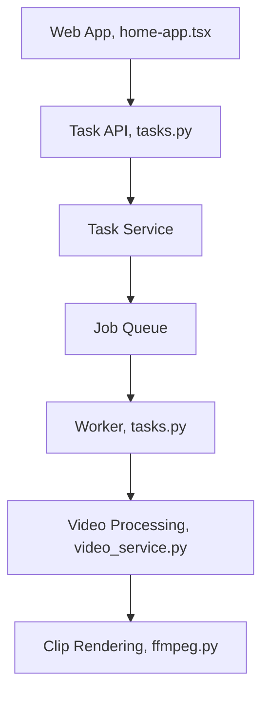

# FujiwaraChoki/supoclip

> Self-hostable tool that cuts a long video into 9:16 vertical clips scored by an LLM.

## The problem
Manually extracting the best moments of a podcast or stream, then reframing and captioning them, takes hours.

## What it actually does
An LLM (Gemini, GPT, Claude or local Ollama) picks 3 to 7 segments from the transcript and gives each a score. Clips are reframed on the face, captioned word by word (AssemblyAI) and titled. An editor, publishing to YouTube, TikTok, Instagram, and an MCP server complete the whole.

## How it is wired


## Trying it
```bash
git clone https://github.com/FujiwaraChoki/supoclip.git
cd supoclip
docker-compose up -d
```
Then open http://localhost:3107.

## Cost and gotchas
Docker, an AssemblyAI key and an LLM provider key are required, at your expense. The license is not identified by GitHub: free non-commercial use, written permission required for companies and teams.

## What it is not
It is not free in the usual sense: commercial use and paid hosting require Shiori LLC's agreement. It is not fully local without extra configuration (Whisper and Ollama).

## Alternatives
OpusClip, cited as the paid service the repository aims to replace.

## For you
Worth watching: an instructive transcription, LLM and rendering pipeline, but the non-standard license and the dependence on AssemblyAI limit its adoption.
