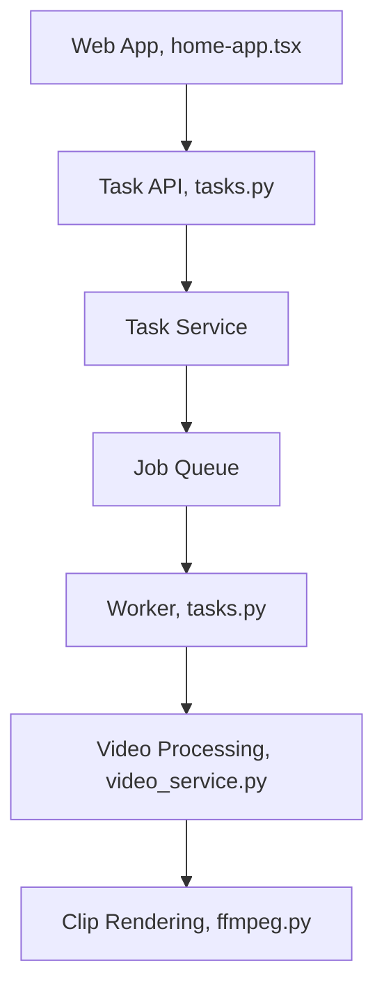

# FujiwaraChoki/supoclip

> Outil auto-hébergeable qui découpe une longue vidéo en clips verticaux 9:16 notés par un LLM.

## Le problème
Extraire à la main les meilleurs moments d'un podcast ou d'un stream, puis les recadrer et sous-titrer, prend des heures.

## Ce que ça fait vraiment
Un LLM (Gemini, GPT, Claude ou Ollama local) choisit 3 à 7 segments dans la transcription et leur attribue un score. Les clips sont recadrés sur le visage, sous-titrés mot à mot (AssemblyAI) et titrés. Un éditeur, la publication YouTube, TikTok, Instagram, et un serveur MCP complètent l'ensemble.

## Comment c'est branché


## Essayer
```bash
git clone https://github.com/FujiwaraChoki/supoclip.git
cd supoclip
docker-compose up -d
```
Puis ouvrir http://localhost:3107.

## Coût et pièges
Docker, une clé AssemblyAI et une clé d'un fournisseur LLM sont nécessaires, à ta charge. La licence n'est pas identifiée par GitHub : usage gratuit non commercial, autorisation écrite requise pour sociétés et équipes.

## Ce que ce n'est pas
Ce n'est pas libre au sens usuel : usage commercial et hébergement payant exigent l'accord de Shiori LLC. Ce n'est pas entièrement local sans configuration supplémentaire (Whisper et Ollama).

## Alternatives
OpusClip, cité comme le service payant que le dépôt veut remplacer.

## Pour toi
À surveiller : pipeline transcription, LLM et rendu instructif, mais la licence non standard et la dépendance à AssemblyAI limitent son adoption.

