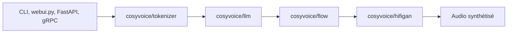

# FunAudioLLM/CosyVoice

> Multilingual text-to-speech with zero-shot voice cloning, for audio product developers.

## The problem
Open synthetic voices handle multiple languages, dialects and the voice of an unknown speaker poorly.

## What it actually does
LLM-based TTS system: 9 languages, 18 Chinese dialects, cross-lingual cloning, instructions (emotion, speed, volume) and text-in / audio-out streaming advertised at 150 ms. Fun-CosyVoice3-0.5B is the recommended model. FastAPI and gRPC servers provided, TensorRT-LLM and vLLM acceleration documented.

## How it is wired


## Trying it
```bash
git clone --recursive https://github.com/FunAudioLLM/CosyVoice.git
conda create -n cosyvoice -y python=3.10
pip install -r requirements.txt
python example.py
```

## Cost and gotchas
GPU required (Docker images launched with `--runtime=nvidia`). Weights are downloaded via ModelScope or Hugging Face. The README points to an Aliyun mirror for pip. Sox and git submodules to manage.

## What it is not
Not a hosted API. The disclaimer specifies academic use, and some examples are taken from the Internet. License not declared: check before any commercial use.

## Alternatives
- F5-TTS, Spark TTS, Index-TTS2, VoxCPM: open models compared in the README's evaluation table.

## For you
Worth watching: relevant if you build voice, but the undeclared license and the mandatory GPU hold back direct use.
