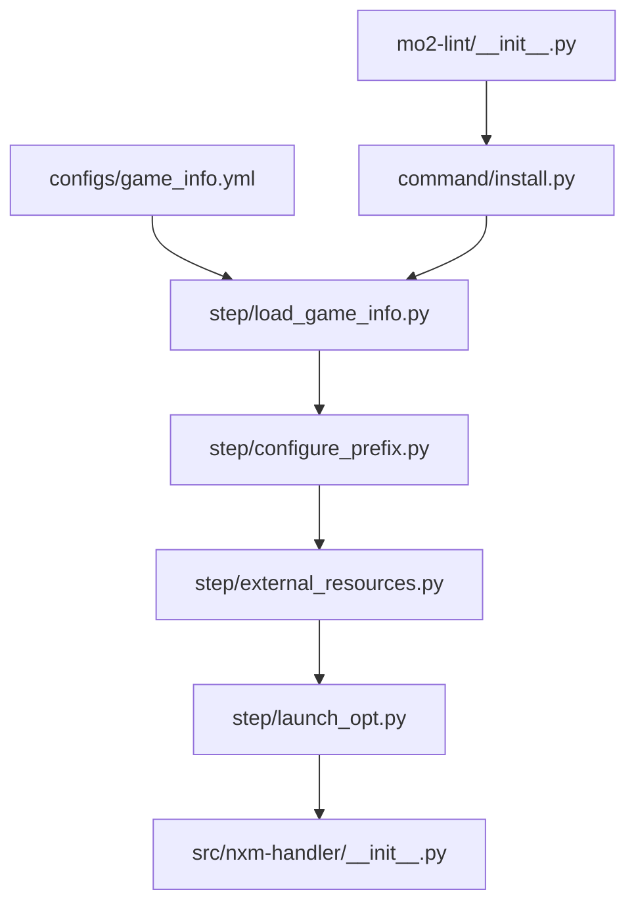

# Furglitch/modorganizer2-linux-installer

> Command-line installer for Mod Organizer 2 on Linux, via Proton.

## The problem
Installing Mod Organizer 2 on Linux requires Proton, Wine, an NXM handler and numerous per-game workarounds.

## What it actually does
`mo2-lint install` configures Proton, downloads MO2, registers the compatibility tools and the Nexus Mods NXM handler. Multiple instances per game, optional script extenders, plugins and themes. Rewritten in Python from a Bash script.

## How it is wired


## Trying it
```bash
mo2-lint install
```

## Cost and gotchas
Free. Downloading from Nexus Mods requires an account. Installation details are on docs.furglitch.com, not in the README.

## What it is not
Not a mod manager itself: it installs the Windows one under Proton.

## Alternatives
No alternative named in the README.

## For you
Ignore: video game modding tool on Linux, outside your data / AI / MLOps scope.
