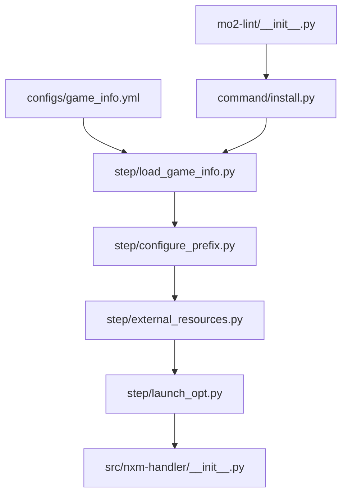

# Furglitch/modorganizer2-linux-installer

> Installeur en ligne de commande de Mod Organizer 2 sous Linux, via Proton.

## Le problème
Installer Mod Organizer 2 sous Linux demande Proton, Wine, un gestionnaire NXM et de nombreux contournements par jeu.

## Ce que ça fait vraiment
`mo2-lint install` configure Proton, télécharge MO2, enregistre les outils de compatibilité et le gestionnaire NXM de Nexus Mods. Plusieurs instances par jeu, extenseurs de scripts, plugins et thèmes en option. Réécrit en Python à partir d'un script Bash.

## Comment c'est branché


## Essayer
```bash
mo2-lint install
```

## Coût et pièges
Gratuit. Le téléchargement depuis Nexus Mods suppose un compte. Les détails d'installation sont sur docs.furglitch.com, pas dans le README.

## Ce que ce n'est pas
Pas un gestionnaire de mods lui-même : il installe celui de Windows sous Proton.

## Alternatives
Aucune alternative nommée dans le README.

## Pour toi
À ignorer : outil de modding de jeux vidéo sous Linux, hors de ton périmètre data / IA / MLOps.

