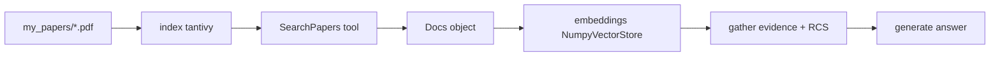

# Future-House/paper-qa

> Agentic RAG over PDFs and scientific literature, with in-text citations.

## The problem
Querying a corpus of scientific papers with a naive RAG gives answers with no verifiable source and misses citation metadata.

## What it actually does
Indexes a folder of PDFs, retrieves metadata (Crossref, Semantic Scholar, Unpaywall) with retraction checking.
Three-phase loop: paper search, evidence gathering with contextualized summary and LLM re-scoring, answer generation.
An agent can reorder these tools, or a `"fake"` agent follows a fixed path to reduce tokens.
Since December 2025: tables, figures, equations, non-English languages, Docling and nemotron-parse readers, multimodal summary.

## How it is wired


## Trying it
```bash
pip install paper-qa
mkdir my_papers
curl -o my_papers/PaperQA2.pdf https://arxiv.org/pdf/2409.13740
cd my_papers
pqa ask 'What is PaperQA2?'
```

## Cost and gotchas
By default everything goes through OpenAI (`gpt-4o-2024-11-20` and `text-embedding-3-small`): a key is mandatory. Beyond 100 papers you also need `CROSSREF_API_KEY` and `SEMANTIC_SCHOLAR_API_KEY` to avoid being rate-limited. The `high_quality` preset is explicitly expensive.

## What it is not
Not a local tool by default: the llama.cpp or ollama mode exists but the README warns that a 7B model gives poor results. Since December 2025 the project uses CalVer, so there is no compatibility guarantee between versions. Pickled `Docs` from before v5 are incompatible.

## Alternatives
LlamaIndex and LangChain — cited in the README FAQ as the expected comparisons.

## For you
The best starting point if you are building a RAG over scientific literature; look especially at its contextualized re-ranking stage.
