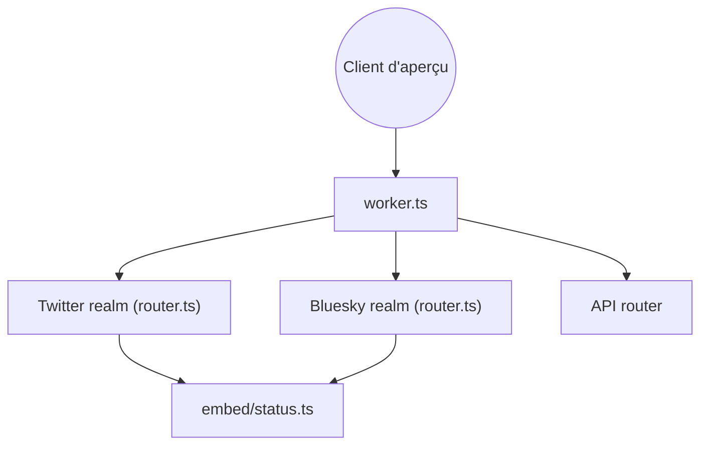

# FxEmbed/FxEmbed

> Cloudflare Worker that turns X and Bluesky links into rich previews in messaging apps.

## The problem
Social post links display poorly in Discord or Telegram.

## What it actually does
A worker routes the request by domain, fetches the post from the social network, normalizes the data and renders HTML with the preview tags. It also exposes APIs and a providers package. Usage: add `fixup` before `x.com` or `fx` before `bsky.app`.

## How it is wired


## Trying it
```bash
cp .env.example .env
cp wrangler.example.toml wrangler.toml
cp branding.example.json branding.json
docker compose up -d --build
```

## Cost and gotchas
Free. The Docker image runs the local Workers runtime via Wrangler (node 24). The `.env` variables are frozen at build time. Depends on the social networks' APIs.

## What it is not
Not affiliated with X Corp. Not a data collection tool.

## Alternatives
No alternative named in the README.

## For you
Ignore: it serves to improve link previews, outside the data / AI / MLOps scope.
