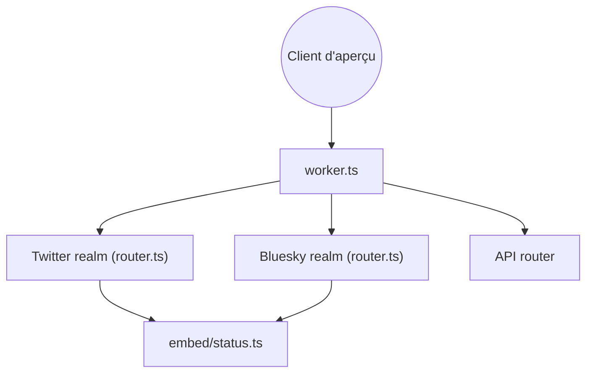

# FxEmbed/FxEmbed

> Worker Cloudflare qui transforme des liens X et Bluesky en aperçus riches dans les messageries.

## Le problème
Les liens de posts sociaux s'affichent mal dans Discord ou Telegram.

## Ce que ça fait vraiment
Un worker route la requête selon le domaine, récupère le post chez le réseau social, normalise les données et rend du HTML avec les balises d'aperçu. Il expose aussi des API et un paquet de fournisseurs. Usage : ajouter `fixup` avant `x.com` ou `fx` avant `bsky.app`.

## Comment c'est branché


## Essayer
```bash
cp .env.example .env
cp wrangler.example.toml wrangler.toml
cp branding.example.json branding.json
docker compose up -d --build
```

## Coût et pièges
Gratuit. L'image Docker lance le runtime Workers local via Wrangler (node 24). Les variables `.env` sont figées au build. Dépend des API des réseaux sociaux.

## Ce que ce n'est pas
Pas affilié à X Corp. Pas un outil de collecte de données.

## Alternatives
Aucune alternative nommée dans le README.

## Pour toi
Ignorer : sert à améliorer des aperçus de liens, hors périmètre data / IA / MLOps.

