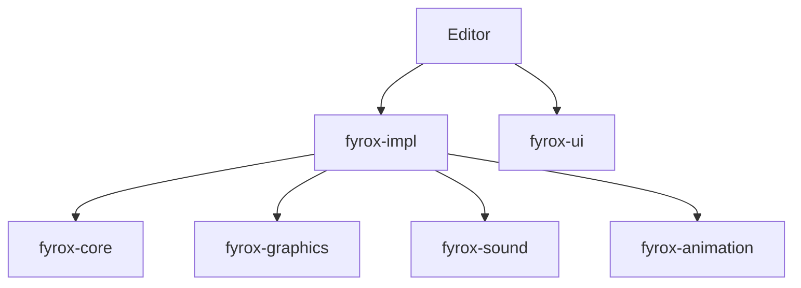

# FyroxEngine/Fyrox

> 2D and 3D game engine in Rust with a scene editor, for game developers.

## The problem
Building a game in Rust requires assembling an engine, editor, UI, audio and animation by hand.

## What it actually does
Provides an engine split into crates (core, impl, graphics, sound, animation, ui, scripts) and a scene editor, with plugins and resources. The README points to the official book and to playable demos in the browser. It states that no AI was used in development.

## How it is wired


## Trying it
```bash
# Aucune commande documentée dans le README (voir le livre officiel).
```

## Cost and gotchas
Free. Rust required, absent from the listed prerequisites: the real need is the Rust toolchain. No startup command in the README.

## What it is not
Not a scientific simulation or AI tool. The provided diagram is a generated description; the links between crates are indicative.

## Alternatives
No alternative named in the README.

## For you
Ignore: a game engine, unrelated to your data / AI / MLOps work.
