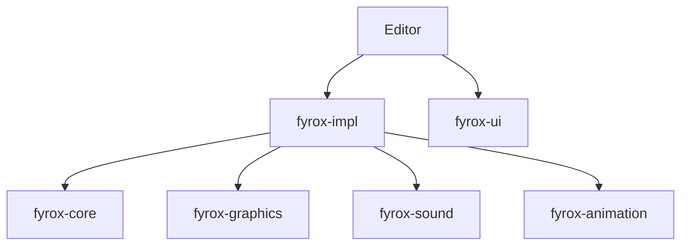

# FyroxEngine/Fyrox

> Moteur de jeu 2D et 3D en Rust avec éditeur de scènes, pour développeurs de jeux.

## Le problème
Créer un jeu en Rust demande moteur, éditeur, interface, audio et animation assemblés à la main.

## Ce que ça fait vraiment
Fournit un moteur en crates (core, impl, graphics, sound, animation, ui, scripts) et un éditeur de scènes, avec plugins et ressources. Le README renvoie au livre officiel et à des démos jouables dans le navigateur. Il affirme qu'aucune IA n'a servi au développement.

## Comment c'est branché


## Essayer
```bash
# Aucune commande documentée dans le README (voir le livre officiel).
```

## Coût et pièges
Gratuit. Rust requis, absent des prérequis listés : le besoin réel est la chaîne Rust. Aucune commande de démarrage dans le README.

## Ce que ce n'est pas
Pas un outil de simulation scientifique ni d'IA. Le diagramme fourni est une description générée, les liens entre crates sont indicatifs.

## Alternatives
Aucune alternative nommée dans le README.

## Pour toi
À ignorer : moteur de jeu, sans lien avec ton travail data / IA / MLOps.

