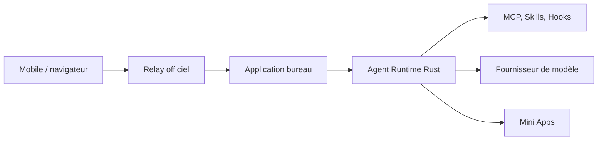

# GCWing/BitFun

> Open-source, customizable agent workspace with remote control from a phone.

## The problem
Coding agents remain tied to one workstation and a fixed interface, hard to adapt to your own tasks.

## What it actually does
Desktop application (Tauri, Rust agent runtime) with four harness modes: Minimal, Standard, Ultimate and Creative. It handles persistent sessions, long-term memory, MCP, Skills, Hooks and specialized agents. Mini Apps are generated via chat. Remote control goes through an official Relay; exchanges between devices are end-to-end encrypted. DeepSWE v1.1 evaluation: 64.6% with GLM-5.3-Flash.

## How it is wired
Simplified diagram based on the sheet, no diagram provided.


## Trying it
```bash
pnpm install
pnpm run desktop:dev
```
README prerequisites: Node.js 22.12+, pnpm 10.15.0, Rust and the Tauri dependencies.

## Cost and gotchas
A model must be configured (API key or subscription at your expense). Remote connection requires an online OpenBitFun account: local network mode is not offline. The Relay sees routing metadata.

## What it is not
Not data-compatible with 0.2.x versions. The README is identical to that of GCWing/OpenBitFun: the two repos seem to be the same project under two names.

## Alternatives
No alternative named in the README.

## For you
Worth watching: an open alternative to a desktop coding agent, but dependent on the account and the Relay, with 111 open issues.
