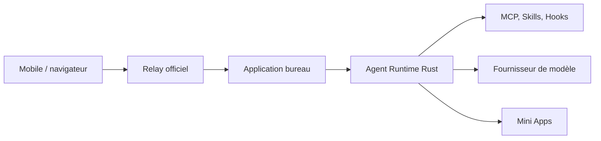

# GCWing/BitFun

> Espace de travail d'agents open source, personnalisable, avec contrôle à distance depuis un téléphone.

## Le problème
Les agents de code restent liés à un poste et à une interface figée, difficiles à adapter à ses propres tâches.

## Ce que ça fait vraiment
Application bureau (Tauri, runtime d'agent en Rust) avec quatre modes d'harnais : Minimal, Standard, Ultimate et Creative. Elle gère sessions persistantes, mémoire longue, MCP, Skills, Hooks et agents spécialisés. Des Mini Apps se génèrent par chat. Le contrôle à distance passe par un Relay officiel ; les échanges entre appareils sont chiffrés de bout en bout. Évaluation DeepSWE v1.1 : 64,6 % avec GLM-5.3-Flash.

## Comment c'est branché
Schéma simplifié d'après la fiche, sans diagramme fourni.


## Essayer
```bash
pnpm install
pnpm run desktop:dev
```
Prérequis du README : Node.js 22.12+, pnpm 10.15.0, Rust et les dépendances Tauri.

## Coût et pièges
Il faut configurer un modèle (clé d'API ou abonnement à ta charge). La connexion à distance exige un compte OpenBitFun en ligne : le mode réseau local n'est pas hors ligne. Le Relay voit les métadonnées de routage.

## Ce que ce n'est pas
Pas compatible en données avec les versions 0.2.x. Le README est identique à celui de GCWing/OpenBitFun : les deux dépôts semblent être le même projet sous deux noms.

## Alternatives
Aucune alternative nommée dans le README.

## Pour toi
À surveiller : alternative ouverte à un agent de code de bureau, mais dépendante du compte et du Relay, avec 111 issues ouvertes.

