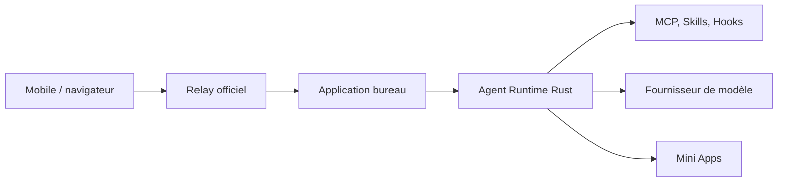

# GCWing/OpenBitFun

> Open-source, customizable agent workspace with remote control from a phone.

## The problem
Coding agents remain tied to one workstation and a fixed interface, hard to adapt to your own tasks.

## What it actually does
Desktop application with a Rust agent runtime and four modes (Minimal, Standard, Ultimate, Creative). It handles persistent sessions, long-term memory, MCP, Skills, Hooks, specialized agents and Mini Apps generated via chat. Remote control goes through an official Relay with end-to-end encryption. DeepSWE v1.1 evaluation: 64.6% with GLM-5.3-Flash and 56.6% with DeepSeek-V4-Flash.

## How it is wired
Simplified diagram based on the sheet, no diagram provided.


## Trying it
```bash
pnpm install
pnpm run desktop:dev
```
README prerequisites: Node.js 22.12+, pnpm 10.15.0, Rust and the Tauri dependencies.

## Cost and gotchas
A model must be configured, with API key or subscription at your expense. Remote connection requires an online account; a private Relay requires a client compiled accordingly.

## What it is not
Not compatible with data from 0.2.x versions. README identical to that of GCWing/BitFun: apparent duplicate of the same project. The DeepSWE figures come from the authors.

## Alternatives
No alternative named in the README.

## For you
Worth watching: same verdict as its twin GCWing/BitFun, to be followed only once, checking which of the two repos is the main one.
