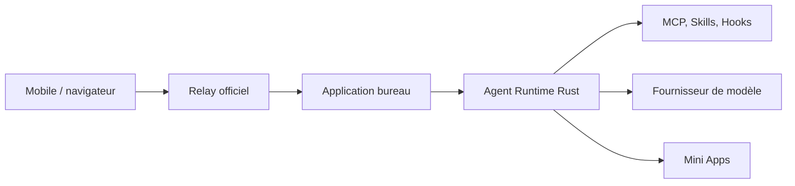

# GCWing/OpenBitFun

> Espace de travail d'agents open source, personnalisable, avec contrôle à distance depuis un téléphone.

## Le problème
Les agents de code restent liés à un poste et à une interface figée, difficiles à adapter à ses propres tâches.

## Ce que ça fait vraiment
Application bureau avec runtime d'agent en Rust et quatre modes (Minimal, Standard, Ultimate, Creative). Elle gère sessions persistantes, mémoire longue, MCP, Skills, Hooks, agents spécialisés et Mini Apps générées par chat. Le contrôle à distance passe par un Relay officiel avec chiffrement de bout en bout. Évaluation DeepSWE v1.1 : 64,6 % avec GLM-5.3-Flash et 56,6 % avec DeepSeek-V4-Flash.

## Comment c'est branché
Schéma simplifié d'après la fiche, sans diagramme fourni.


## Essayer
```bash
pnpm install
pnpm run desktop:dev
```
Prérequis du README : Node.js 22.12+, pnpm 10.15.0, Rust et les dépendances Tauri.

## Coût et pièges
Modèle à configurer, avec clé d'API ou abonnement à ta charge. La connexion à distance demande un compte en ligne ; un Relay privé exige un client compilé en conséquence.

## Ce que ce n'est pas
Pas compatible avec les données des versions 0.2.x. README identique à celui de GCWing/BitFun : doublon apparent du même projet. Les chiffres DeepSWE viennent des auteurs.

## Alternatives
Aucune alternative nommée dans le README.

## Pour toi
À surveiller : même verdict que son jumeau GCWing/BitFun, à ne suivre qu'une fois, en vérifiant lequel des deux dépôts est le principal.

