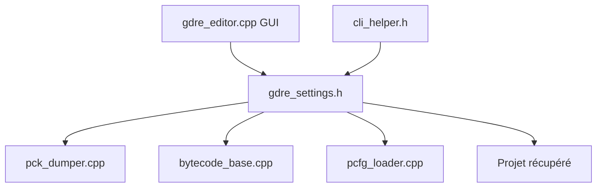

# GDRETools/gdsdecomp

> Tools to recover a Godot project from a PCK, an APK or an EXE, and to manipulate archives.

## The problem
A lost Godot project or one without sources cannot be reopened from the exported game.

## What it actually does
It loads a PCK, an APK or an EXE, extracts the resources, decompiles GDScript scripts, restores the project file, converts imported resources and recreates the plugin configuration. It handles Godot 4.x, 3.x and 2.x. It also creates or fixes PCKs, converts text and binary scenes and fixes translations.

## How it is wired
Diagram based on the one provided.



## Trying it
```bash
scoop bucket add games
scoop install gdsdecomp
gdre_tools --headless --recover=<GAME_PCK/EXE/APK/DIR>
gdre_tools --headless --extract=<GAME_PCK/EXE/APK>
```

## Cost and gotchas
Free. Building from source requires a modified version of Godot, rustup and the dotnet 10 SDK. 2.x models, GDNative and GDExtension are not handled.

## What it is not
Not a guaranteed piracy tool: recovery depends on the Godot version and on a key for encrypted projects. It does not make the resources match the original for certain.

## Alternatives
No alternative named in the README.

## For you
Ignore: useful only to recover your own Godot projects, far from your field; only extract games you have the rights to.
