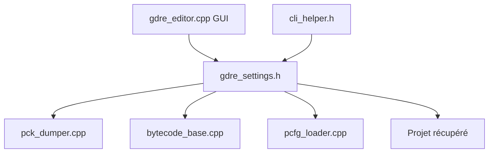

# GDRETools/gdsdecomp

> Outils pour récupérer un projet Godot depuis un PCK, un APK ou un EXE, et manipuler les archives.

## Le problème
Un projet Godot perdu ou sans sources ne se rouvre pas à partir du jeu exporté.

## Ce que ça fait vraiment
Il charge un PCK, un APK ou un EXE, extrait les ressources, décompile les scripts GDScript, restaure le fichier projet, convertit les ressources importées et recrée la configuration des plugins. Il gère Godot 4.x, 3.x et 2.x. Il crée ou corrige aussi des PCK, convertit scènes texte et binaire et corrige des traductions.

## Comment c'est branché
Schéma d'après le diagramme fourni.



## Essayer
```bash
scoop bucket add games
scoop install gdsdecomp
gdre_tools --headless --recover=<GAME_PCK/EXE/APK/DIR>
gdre_tools --headless --extract=<GAME_PCK/EXE/APK>
```

## Coût et pièges
Gratuit. Compiler depuis les sources demande une version modifiée de Godot, rustup et le SDK dotnet 10. Les modèles 2.x, GDNative et GDExtension ne sont pas gérés.

## Ce que ce n'est pas
Pas un outil de piratage garanti : la récupération dépend de la version de Godot et d'une clé pour les projets chiffrés. Il ne rend pas les ressources conformes à l'original à coup sûr.

## Alternatives
Aucune alternative nommée dans le README.

## Pour toi
À ignorer : utile seulement pour récupérer ses propres projets Godot, loin de ton domaine ; n'extrais que des jeux dont tu as les droits.

