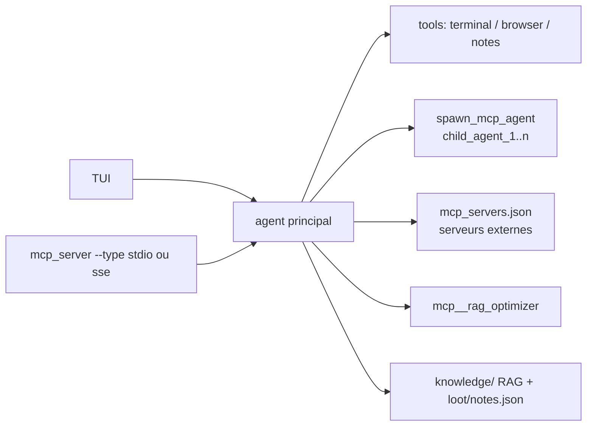

# GH05TCREW/pentestagent

> Penetration-testing agent in a TUI, multi-agent and MCP-compatible, for authorized pentesters.

## The problem
A penetration test chains dozens of CLI tools and scattered notes.
Parallelizing reconnaissance across several subnets requires manual orchestration.

## What it actually does
Four modes: `/assist` (one instruction), `/agent` (autonomous), `/crew` (orchestrator + workers),
`/interact` (guided). Built-in tools: `terminal`, `browser`, `notes`, `web_search`, `spawn_mcp_agent`.
Self-swarming: an agent launches a copy of itself as an isolated child MCP server, whose tools are fed
back to the parent (`/spawn`, `/despawn`). Predefined attack playbooks.
MCP in both directions: consuming external servers, and exposing itself over stdio or SSE.
Beyond 128 tools, an embedding-similarity `mcp__rag_optimizer` replaces the catalog.
RAG over `pentestagent/knowledge/sources/`, notes in `loot/notes.json`, shadow graph in Crew mode.

## How it is wired


## Trying it
```bash
git clone https://github.com/GH05TCREW/pentestagent.git
pip install -e ".[all]"
playwright install chromium
pentestagent -t 192.168.1.1
pentestagent tui --docker
docker run -it --rm -e ANTHROPIC_API_KEY=your-key ghcr.io/gh05tcrew/pentestagent:kali
pentestagent run -t example.com --playbook thp3_web
```

## Cost and gotchas
Python 3.10+, a LiteLLM key (OpenAI, Anthropic or other) at your expense, `TAVILY_API_KEY` for web search.
Docker mode isolates and pre-installs the Kali tools. Swarming multiplies model calls,
hence the bill. The README reminds you of the legal framework: only systems you are authorized to test.

## What it is not
It is not a deterministic scanner: it is an agent that decides its own commands.
It is not a guarantee of coverage — the playbooks give structure, they certify nothing.
It is not risk-free: an agent with a terminal and msfconsole can do damage outside the scope.

## Alternatives
None named; only `gc-nmap-mcp` as an example of an external MCP server.

## For you
Outside your focus, except for the idea of MCP self-swarming and RAG over a tool catalog, which are transferable.
