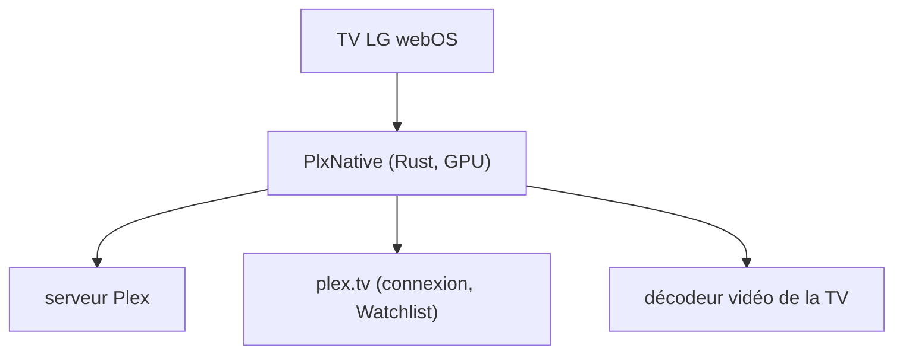

# GLinnik21/plx-native

> Unofficial, native Plex client for LG webOS TVs, written almost entirely in Rust.

## The problem
The official Plex app on older LG TVs is slow because it is a web page running in Chromium.

## What it actually does
An interface drawn directly on the GPU at 60 frames per second, with video decoded by the TV's hardware. QR code login, Plex Home profiles, libraries, search, direct H.264 and HEVC playback, server transcoding otherwise. Movies and shows only.

## How it is wired
Simplified diagram based on the sheet, no diagram provided.

## Trying it
No command in the README: installation goes through LG Developer Mode and webOS Dev Manager, or through Homebrew Channel, following the repository's installation guide.

## Cost and gotchas
Free, but you need a Plex account and an LG webOS 4.0 or later TV. Developer Mode expires and must be renewed, otherwise LG removes the app. Some 2019 models (k5lp, k3lp chips) cannot play video.

## What it is not
Not affiliated with Plex or LG. No music, photos or live TV. Crash reports and telemetry are disabled by default.

## Alternatives
No alternative named in the README.

## For you
Ignore: a TV client for Plex has nothing to do with data / AI / MLOps work, even if it is well made.
