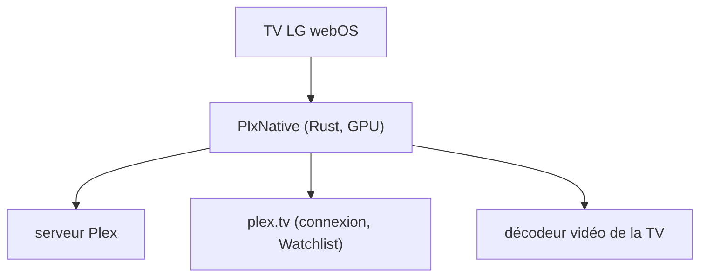

# GLinnik21/plx-native

> Client Plex non officiel et natif pour téléviseurs LG webOS, écrit presque entièrement en Rust.

## Le problème
L'application Plex officielle des vieux LG est lente car c'est une page web dans Chromium.

## Ce que ça fait vraiment
Une interface dessinée directement sur le GPU à 60 images par seconde, avec la vidéo décodée par le matériel de la TV. Connexion par QR code, profils Plex Home, bibliothèques, recherche, lecture directe H.264 et HEVC, transcodage serveur sinon. Films et séries seulement.

## Comment c'est branché
Schéma simplifié d'après la fiche, sans diagramme fourni.

## Essayer
Aucune commande dans le README : l'installation passe par le Mode Développeur LG et webOS Dev Manager, ou par Homebrew Channel, avec le guide d'installation du dépôt.

## Coût et pièges
Gratuit, mais il faut un compte Plex et une TV LG webOS 4.0 ou plus. Le Mode Développeur expire et doit être renouvelé, sinon LG retire l'appli. Certains modèles 2019 (puces k5lp, k3lp) ne lisent pas la vidéo.

## Ce que ce n'est pas
Pas affilié à Plex ni à LG. Pas de musique, photos ni TV en direct. Les rapports de plantage et la télémétrie sont désactivés par défaut.

## Alternatives
Aucune alternative nommée dans le README.

## Pour toi
Ignorer : un client TV pour Plex n'a aucun rapport avec un travail data / IA / MLOps, même s'il est bien fait.

