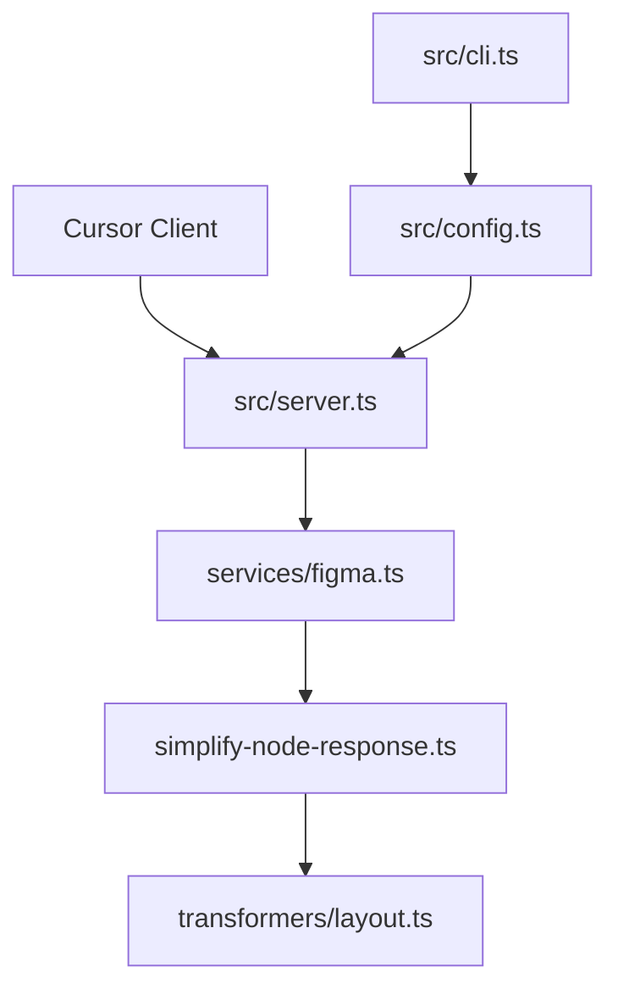

# GLips/Figma-Context-MCP

> MCP server giving Cursor and other coding agents simplified access to Figma design data.

## The problem
A coding agent implementing a mockup from screenshots loses accuracy. It needs the actual layout data.

## What it actually does
The server fetches a file's, frame's or group's metadata through the Figma API, then simplifies and translates it to keep only layout and style. The agent receives less context, so more relevant context. It is configured in the client's MCP config file.

## How it is wired


## Trying it
```bash
npx -y figma-developer-mcp --figma-api-key=YOUR-KEY --stdio
```

## Cost and gotchas
You must create a Figma access token. The key can be passed through the `FIGMA_API_KEY` and `PORT` environment variables.

## What it is not
Not a code generator: it is a context provider. The README says it is designed specifically for Cursor. It does not replace Figma.

## Alternatives
No alternative named in the README.

## For you
Watch: useful only if you do front-end integration with an agent; little connection to data/MLOps work.
