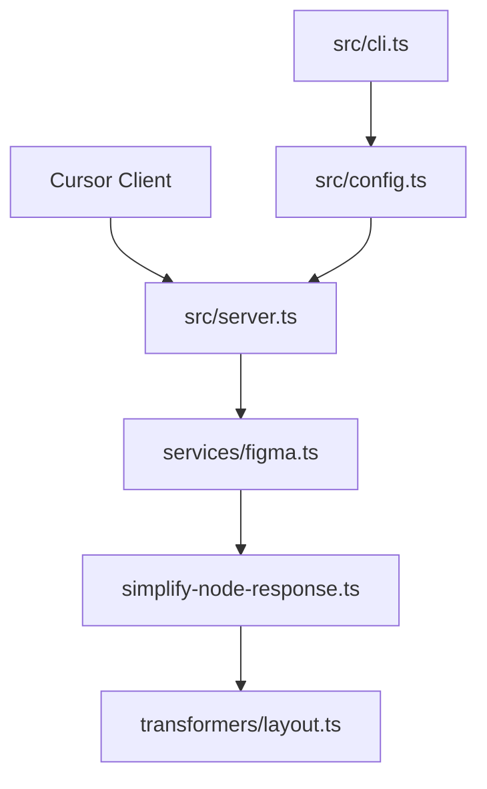

# GLips/Figma-Context-MCP

> Serveur MCP donnant à Cursor et autres agents de code l'accès simplifié aux données de design Figma.

## Le problème
Un agent de code qui implémente une maquette à partir de captures d'écran perd en précision. Il lui faut les données de mise en page réelles.

## Ce que ça fait vraiment
Le serveur récupère via l'API Figma les métadonnées d'un fichier, cadre ou groupe, puis les simplifie et les traduit pour ne garder que la mise en page et le style. L'agent reçoit moins de contexte, donc plus pertinent. Il se configure dans le fichier de config MCP du client.

## Comment c'est branché


## Essayer
```bash
npx -y figma-developer-mcp --figma-api-key=YOUR-KEY --stdio
```

## Coût et pièges
Il faut créer un jeton d'accès Figma. La clé peut passer par `FIGMA_API_KEY` et `PORT` en variables d'environnement.

## Ce que ce n'est pas
Pas un générateur de code : c'est un fournisseur de contexte. Le README dit qu'il est conçu spécifiquement pour Cursor. Il ne remplace pas Figma.

## Alternatives
Aucune alternative nommée dans le README.

## Pour toi
À surveiller : utile seulement si tu fais de l'intégration front avec un agent ; peu de lien avec un travail data/MLOps.

