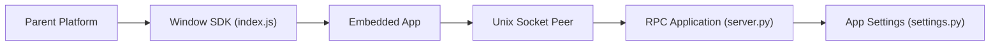

# GMSSH/GMSSH

> SSH access and multi-host management platform, lighter than a control panel, for small teams.

## The problem
Scattered SSH addresses, keys and accounts make managing many servers and sharing access messy.

## What it actually does
The README mostly describes a positioning: host management, groups and tags, a unified access entry point, terminal and files, collaboration, a lightweight component launched on demand. It notes that permissions and audit are "being improved" and that the capability list "may be adjusted". The code provided is a skeleton (Python RPC, Go packages, JS SDK), not the platform.

## How it is wired

## Trying it
No command in the README: Docker deployment via https://www.gm.cn/private, documentation at https://doc.gm.cn/zh/guide/.

## Cost and gotchas
Docker mode goes through an external page, not documented in the repository. No license declared although the README claims "open source".

## What it is not
Not an enterprise bastion (limited audit and governance), not a server administration panel. The visible code does not prove the announced features.

## Alternatives
No alternative named; the README only compares by categories (native SSH, panels, bastions).

## For you
Ignore: server administration is off-topic for data or AI, and the openness of the code is neither licensed nor visible.
