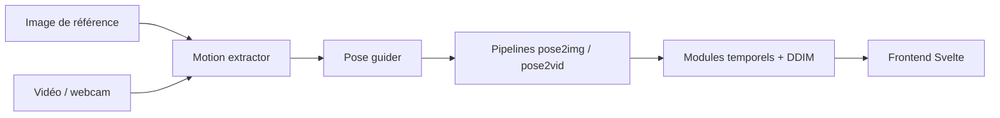

# GVCLab/PersonaLive

> Real-time diffusion framework that animates a portrait from a driving video, for research.

## The problem
Animating a portrait as a continuous stream, for an indefinite duration, requires a diffusion model that is fast enough and temporally consistent.

## What it actually does
A reference image is animated by the motion of a video or a webcam. Motion extractor derived from LivePortrait, pose guider, 2D/3D UNets and temporal modules, DDIM scheduler. Svelte interface on port 7860; TensorRT for about 2× speed. Three-stage training (code published).

## How it is wired


## Trying it
```bash
conda create -n personalive python=3.10
conda activate personalive
pip install -r requirements_base.txt
python tools/download_weights.py
python inference_offline.py
python inference_online.py --acceleration none
```

## Cost and gotchas
GPU required; the provided TensorRT engine comes from an H100 and must be rebuilt (`python torch2trt.py`, about 20 minutes). On RTX 50, disable xformers. Training is announced on 8× H100 (about 48 h in total).

## What it is not
"Academic research only" according to the disclaimer; do not generate harmful or defamatory content. An animated portrait poses an identity-impersonation risk.

## Alternatives
- ComfyUI-PersonaLive: ComfyUI integration cited.
- EditaLive: updated version of the same project.

## For you
Watch: an interesting technique if you work on generative video, but usage is restricted to research.
