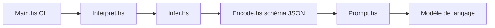

# Gabriella439/grace

> Langage dédié à la composition de prompts, avec schémas JSON déduits du typage.

## Le problème
Enchaîner des appels de modèles et structurer leurs sorties demande beaucoup de code de colle.

## Ce que ça fait vraiment
Fonction intégrée `prompt` ; le vérificateur de types déduit le schéma JSON attendu à partir de l'usage et contraint la sortie du modèle. `import prompt` génère du code Grace. CLI Haskell : `interpret`, `text`, `format`, `builtins`, `repl`. Utilisable sans installation sur trygrace.dev.

## Comment c'est branché


## Essayer
```bash
grace --help
grace interpret ./greet.ffg
grace repl
```

## Coût et pièges
Clé de fournisseur (les exemples utilisent un fichier de clé OpenAI) ; appels facturés par le fournisseur.

## Ce que ce n'est pas
Pas un framework d'agents : un langage de petite taille centré sur les types.

## Alternatives
Aucune alternative nommée dans le README.

## Pour toi
À surveiller : l'idée de déduire le schéma de sortie du typage vaut d'être connue pour tes chaînes de prompts ; langage de niche encore.

