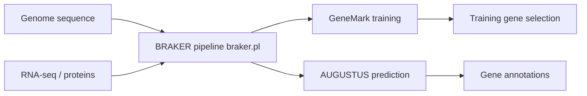

# Gaius-Augustus/BRAKER

> Gene annotation pipeline for eukaryotic genomes, using RNA-Seq and proteins, now deprecated in favor of BRAKER4.

## The problem
Annotating the genes of a newly sequenced genome requires training several predictors and integrating external evidence.

## What it actually does
`braker.pl` orchestrates GeneMark-ES/ET/EP/ETP and AUGUSTUS: automatic training, integration of RNA-Seq or protein hints (OrthoDB), then TSEBRA to merge the predictions. It outputs a gene set as GTF, coding sequences and proteins. A Singularity container avoids manually installing many dependencies.

## How it is wired


## Trying it
```
singularity build braker3.sif docker://teambraker/braker3:latest
singularity exec braker3.sif braker.pl
braker.pl --genome=genome.fa --prot_seq=proteins.fa
```

## Cost and gotchas
Repeat-masked genome, large protein databases, a lot of CPU and time. The conda installation is not supported for GeneMark-ETP. UTR prediction is experimental. The README states that BRAKER is deprecated.

## What it is not
Not a general-purpose AI tool: this is genomics bioinformatics. Artistic license stated in the README, but not recognized by GitHub.

## Alternatives
BRAKER4 (recommended by the README), GALBA (a Miniprot variant).

## For you
Ignore: deprecated and specific to genomics, unless you need to reproduce an existing annotation before moving to BRAKER4.
