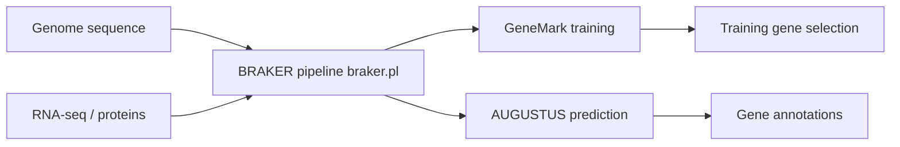

# Gaius-Augustus/BRAKER

> Pipeline d'annotation de gènes sur génomes eucaryotes, avec RNA-Seq et protéines, aujourd'hui déprécié au profit de BRAKER4.

## Le problème
Annoter les gènes d'un génome nouvellement séquencé exige d'entraîner plusieurs prédicteurs et d'intégrer des preuves externes.

## Ce que ça fait vraiment
`braker.pl` orchestre GeneMark-ES/ET/EP/ETP et AUGUSTUS : entraînement automatique, intégration d'indices RNA-Seq ou protéines (OrthoDB), puis TSEBRA pour fusionner les prédictions. Il sort un jeu de gènes en GTF, séquences codantes et protéines. Un conteneur Singularity évite l'installation manuelle de nombreuses dépendances.

## Comment c'est branché


## Essayer
```
singularity build braker3.sif docker://teambraker/braker3:latest
singularity exec braker3.sif braker.pl
braker.pl --genome=genome.fa --prot_seq=proteins.fa
```

## Coût et pièges
Génome masqué pour les répétitions, bases de protéines volumineuses, beaucoup de CPU et de temps. L'installation conda n'est pas supportée pour GeneMark-ETP. La prédiction des UTR est expérimentale. Le README annonce que BRAKER est déprécié.

## Ce que ce n'est pas
Pas un outil d'IA généraliste : c'est de la bio-informatique de génomique. Licence Artistic indiquée dans le README, mais non reconnue par GitHub.

## Alternatives
BRAKER4 (recommandé par le README), GALBA (variante pour Miniprot).

## Pour toi
Ignorer : déprécié et spécifique à la génomique, sauf si tu dois reproduire une annotation existante avant de passer à BRAKER4.

