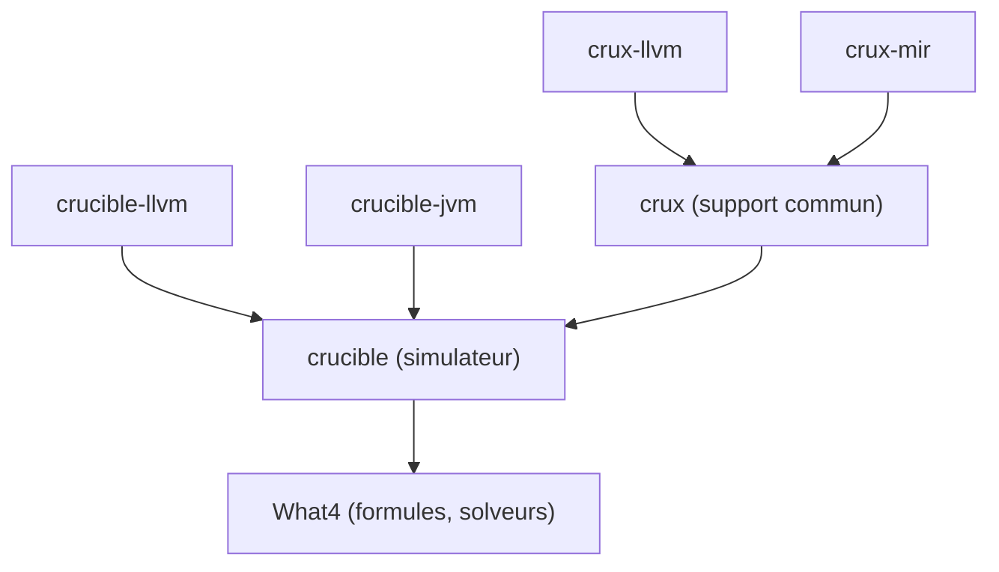

# GaloisInc/crucible

> Haskell library for symbolic execution of imperative programs, to verify C, C++, Rust or JVM code.

## The problem
Proving the absence of certain defects, or finding counterexamples, requires a symbolic execution engine that talks to SMT solvers.

## What it actually does
Represents programs as control-flow graphs and explores them by forward symbolic execution, with What4 for formulas and SAT/SMT solvers. Packages translate LLVM (crux-llvm for C and C++), JVM bytecode and Rust (crux-mir), with a debugger and CLIs for developers.

## How it is wired


## Trying it
```bash
git submodule update --init
cabal update
cabal new-configure
cabal new-build all
cabal test
```

## Cost and gotchas
Free. Haskell toolchain (cabal), clang for crux-llvm, and for crux-mir the mir-json tool plus translated Rust libraries. 231 open issues.

## What it is not
Not a turnkey tool for software testing: it is a set of research building blocks for verification. DARPA funding is mentioned.

## Alternatives
No alternative cited in the README.

## For you
Keep an eye on it: relevant for verifying critical code or native libraries, far from a data or MLOps daily routine.
