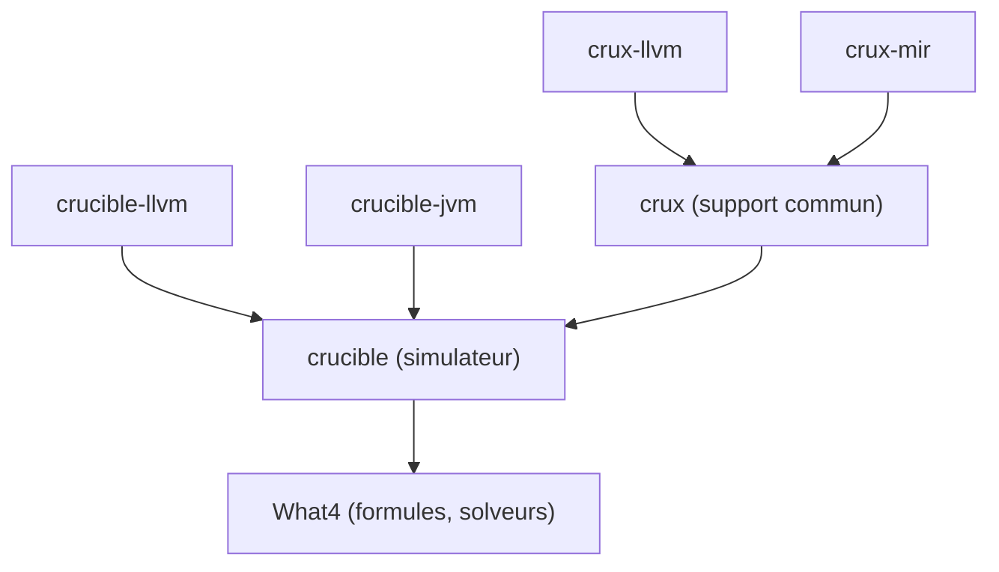

# GaloisInc/crucible

> Bibliothèque Haskell d'exécution symbolique de programmes impératifs, pour vérifier du code C, C++, Rust ou JVM.

## Le problème
Prouver l'absence de certains défauts, ou trouver des contre-exemples, demande un moteur d'exécution symbolique qui parle aux solveurs SMT.

## Ce que ça fait vraiment
Représente des programmes en graphes de flot de contrôle et les explore par exécution symbolique avant, avec What4 pour les formules et les solveurs SAT/SMT. Des paquets traduisent du LLVM (crux-llvm pour C et C++), du bytecode JVM et du Rust (crux-mir), avec un débogueur et des CLI pour développeurs.

## Comment c'est branché


## Essayer
```bash
git submodule update --init
cabal update
cabal new-configure
cabal new-build all
cabal test
```

## Coût et pièges
Gratuit. Chaîne Haskell (cabal), clang pour crux-llvm, et pour crux-mir l'outil mir-json plus des bibliothèques Rust traduites. 231 issues ouvertes.

## Ce que ce n'est pas
Pas un outil clé en main pour tests de logiciels : c'est un ensemble de briques de recherche en vérification. Le financement DARPA est mentionné.

## Alternatives
Aucune alternative citée dans le README.

## Pour toi
Surveiller : pertinent pour la vérification de code critique ou de bibliothèques natives, éloigné d'un quotidien data ou MLOps.

