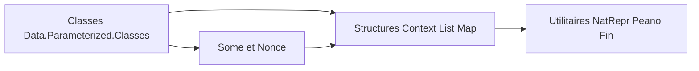

# GaloisInc/parameterized-utils

> Haskell library of classes and data structures for parameterized types (GADTs), for compiler and analyzer developers.

## The problem
Type-indexed GADTs prevent storing values of different types in the same list or table, without tricks.

## What it actually does
Provides classes (`EqF`, `OrdF`, `ShowF`, `HashableF`), structures (Assignment, List, MapF, HashTable, Vector) and type-level proof utilities (NatRepr, Peano, Fin, Some, Nonce). The default implementation of `Assignment` uses `unsafeCoerce` for efficiency, as opposed to a safe version that serves as proof.

## How it is wired

## Trying it
No command documented in the README.

## Cost and gotchas
Haskell required (outside the prerequisites list, hence `none`) and a good command of GADTs and DataKinds. The README does not say how to install it.

## What it is not
It is not numerical computing or data work: it is type programming. `Nonce` is only safe if no value is reused.

## Alternatives
- singletons: a related notion, more automated, but less flexible according to the README.

## For you
Ignore: a Haskell type-theory use case, unrelated to a data, AI or MLOps profile.
