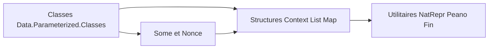

# GaloisInc/parameterized-utils

> Bibliothèque Haskell de classes et structures de données pour types paramétrés (GADT), pour développeurs de compilateurs et analyseurs.

## Le problème
Les GADT indexés par un type empêchent de ranger des valeurs de types différents dans une même liste ou une même table, sans astuces.

## Ce que ça fait vraiment
Fournit des classes (`EqF`, `OrdF`, `ShowF`, `HashableF`), des structures (Assignment, List, MapF, HashTable, Vector) et des utilitaires de preuve au niveau des types (NatRepr, Peano, Fin, Some, Nonce). L'implémentation par défaut d'`Assignment` utilise `unsafeCoerce` pour l'efficacité, face à une version sûre qui sert de preuve.

## Comment c'est branché

## Essayer
Aucune commande documentée dans le README.

## Coût et pièges
Haskell requis (hors liste de prérequis, d'où `aucun`) et une bonne maîtrise des GADT et DataKinds. Le README ne dit pas comment l'installer.

## Ce que ce n'est pas
Ce n'est pas du calcul numérique ou de la donnée : c'est de la programmation de types. `Nonce` n'est sûr que si aucune valeur n'est réutilisée.

## Alternatives
- singletons : notion proche, plus automatisée, mais moins flexible selon le README.

## Pour toi
À ignorer : cas d'usage de théorie des types en Haskell, sans rapport avec un profil data, IA ou MLOps.

