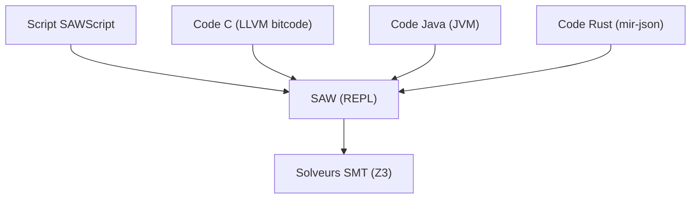

# GaloisInc/saw-script

> Software analysis workbench that formally proves C, Java, Rust and Cryptol programs.

## The problem
Tests do not prove that cryptographic or critical code is correct for all inputs.

## What it actually does
SAW reasons about formal models of C programs (via LLVM), Java (JVM), Rust (MIR via mir-json) and Cryptol. SAWScript is its driving language. It relies on SMT solvers, of which Z3 is mandatory.

## How it is wired
Simplified diagram based on the sheet, no diagram provided.


## Trying it
```bash
git submodule update --init
./build.sh
```

## Cost and gotchas
Z3 required on the PATH; building needs ghc, cabal, ncurses, zlib. Prebuilt binaries and a Docker image exist. 522 open issues.

## What it is not
Not a linter or a testing tool: it is formal verification, demanding to learn.

## Alternatives
None named in the README.

## For you
Watch: interesting for proving critical code, but a steep learning curve and outside your day-to-day data / AI work.
