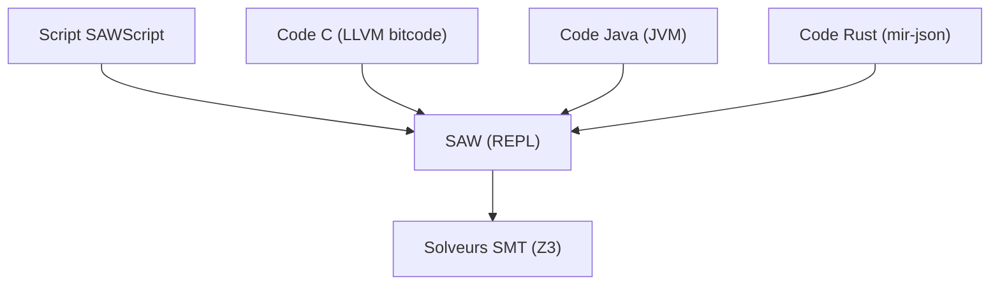

# GaloisInc/saw-script

> Atelier d'analyse de logiciels qui prouve formellement des programmes C, Java, Rust et Cryptol.

## Le problème
Les tests ne prouvent pas qu'un code cryptographique ou critique est correct pour toutes les entrées.

## Ce que ça fait vraiment
SAW raisonne sur des modèles formels de programmes C (via LLVM), Java (JVM), Rust (MIR via mir-json) et Cryptol. SAWScript est son langage de pilotage. Il s'appuie sur des solveurs SMT, dont Z3 obligatoire.

## Comment c'est branché
Schéma simplifié d'après la fiche, sans diagramme fourni.


## Essayer
```bash
git submodule update --init
./build.sh
```

## Coût et pièges
Z3 requis sur le PATH ; compilation avec ghc, cabal, ncurses, zlib. Binaires précompilés et image Docker existent. 522 issues ouvertes.

## Ce que ce n'est pas
Pas un linter ni un outil de test : c'est de la vérification formelle, exigeante à apprendre.

## Alternatives
Aucune nommée dans le README.

## Pour toi
À surveiller : intéressant pour prouver du code critique, mais courbe d'apprentissage forte et hors de ton quotidien data / IA.

