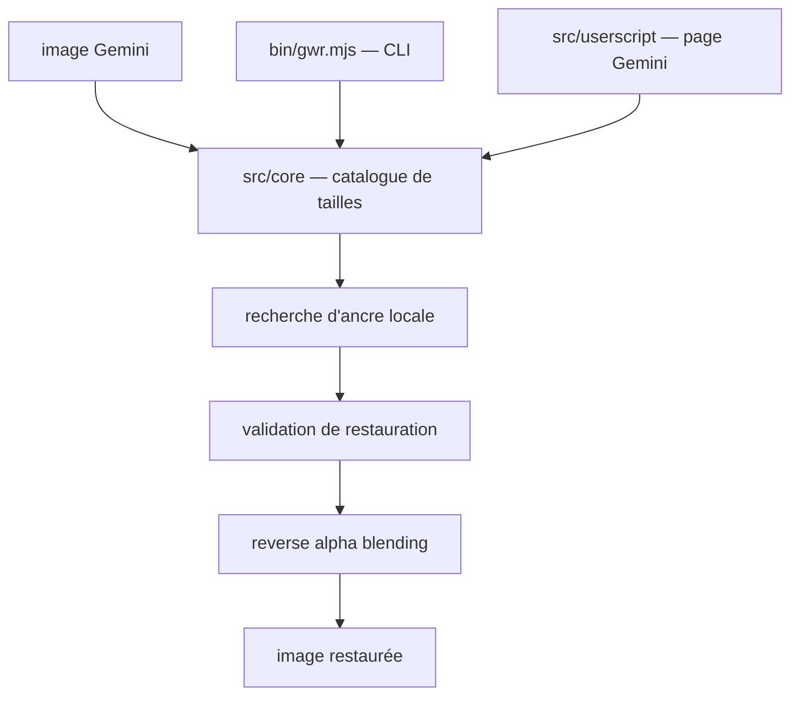

# GargantuaX/gemini-watermark-remover

> JavaScript tool that removes the visible watermark from images generated by Gemini.

## The problem
Images produced by Gemini carry a semi-transparent logo at the bottom right.
AI retouching tools "guess" the missing pixels and damage the surrounding image.

## What it actually does
It does not inpaint: it inverts the alpha compositing equation. Gemini applies `watermarked = α·logo + (1−α)·original`; the tool solves `original = (watermarked − α·logo) / (1 − α)`.
The exact alpha map was reconstructed by capturing the watermark on a known solid background, hence a lossless restoration on recognized formats.
Detection has three layers: matching dimensions against the catalog of Gemini output sizes, local anchor search around the predicted position, then validating the restoration before applying it.
Five usage surfaces: online site, Chrome extension, Tampermonkey userscript, `gwr` CLI, and a packaged skill for coding agents.

## How it is wired


## Trying it
```bash
node bin/gwr.mjs remove <input> --output <file>
gwr remove <input> [--output <file> | --out-dir <dir>] [--overwrite] [--json]
pnpm dlx @pilio/gemini-watermark-remover remove <input> --output <file>
pnpm dlx skills add GargantuaX/gemini-watermark-remover --skill gemini-watermark-remover
```

## Cost and gotchas
Free, MIT, all processing is local — nothing is uploaded. The default CLI decoder requires `sharp` installed next to the package.
Canvas fingerprint-defense extensions make processing fail; the README points to the corresponding issue.

## What it is not
It is not a universal watermark remover: only Gemini's visible logo, validated up to April 2026, and nothing against invisible markings like SynthID.
The README repeatedly pushes toward pilio.ai, the same author's commercial product, for everything else.
Legal matters are left to the user: the author disclaims all responsibility for usage.

## Alternatives
- Gemini Watermark Tool (Allen Kuo): the original of which this repo is the JavaScript port.
- pilio.ai/image-watermark-remover: the same author's generic AI service, for non-Gemini watermarks.

## For you
Of no professional interest, but the alpha algebra demonstration is clean and the refusal of AI inpainting is instructive.
