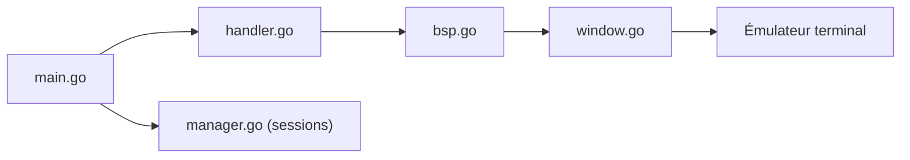

# Gaurav-Gosain/tuios

> Modal terminal multiplexer and window manager in Go, with BSP tiling and persistent sessions.

## The problem
tmux lacks dynamic tiling, kitty graphics and a modal window-manager-style interface.

## What it is not actually doing
See below.

## What it actually does
Panes, 9 workspaces, a command palette, an application launcher, BSP, master-stack and scrolling modes. Kitty protocols (images, keyboard) and sixel, daemon mode with detaching, "tape" scripts, an SSH server and a web terminal. The architecture also hints at agent and review features, not detailed in the README.

## How it is wired


## Trying it
```bash
brew tap Gaurav-Gosain/tap
brew install tuios
tuios
tuios new mysession
tuios attach mysession
```

## Cost and gotchas
Free. A true color terminal is required; kitty/sixel recommended (Ghostty, Kitty, WezTerm). Repository created in September 2025, so it is young.

## What it is not
Not a proven replacement for tmux. Sixel is marked experimental.

## Alternatives
tmux, cited for comparison in the README (separators, detachable sessions).

## For you
Terminal comfort for working on GPU servers, with no direct data gain: keep an eye on it.
