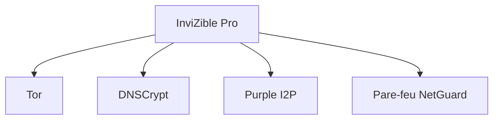

# Gedsh/InviZible

> Android app that brings together Tor, DNSCrypt and I2P to protect online privacy.

## The problem
Avoiding tracking, censorship and DNS eavesdropping on mobile requires assembling several network tools.

## What it actually does
Runs three modules: Tor (multi-hop routing, onion sites), DNSCrypt (encrypted DNS, optional blocking depending on the server) and Purple I2P (eepsites). Includes a firewall based on NetGuard. Usable with or without root. No support for building it yourself.

## How it is wired
Simplified diagram based on the sheet, no diagram provided.



## Trying it
```bash
git clone --recursive https://github.com/Gedsh/InviZible
# Compilation avec Android Studio ; sinon APK précompilés (GitHub, F-Droid, Google Play).
```

## Cost and gotchas
Free, cryptocurrency donations. Some features (DNSCrypt blocking) are missing from the Google Play version. The README says the author does not support build problems.

## What it is not
Not a VPN in the classic sense; the claim "more stable than free VPNs" comes from the author. A product independent of Tor, DNSCrypt and I2P.

## Alternatives
No alternative named in the README.

## For you
Ignore: a mobile privacy tool, outside the data/AI/MLOps scope.
