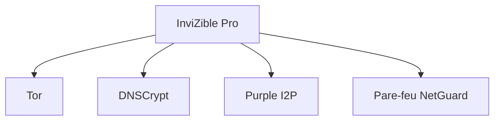

# Gedsh/InviZible

> Application Android qui réunit Tor, DNSCrypt et I2P pour protéger la vie privée en ligne.

## Le problème
Éviter le pistage, la censure et l'écoute DNS sur mobile demande d'assembler plusieurs outils réseau.

## Ce que ça fait vraiment
Fait tourner trois modules : Tor (routage multi-nœuds, sites onion), DNSCrypt (DNS chiffré, blocage optionnel selon le serveur) et Purple I2P (sites eepsites). Inclut un pare-feu basé sur NetGuard. Utilisable avec ou sans root. Aucun support pour la compilation soi-même.

## Comment c'est branché
Schéma simplifié d'après la fiche, sans diagramme fourni.



## Essayer
```bash
git clone --recursive https://github.com/Gedsh/InviZible
# Compilation avec Android Studio ; sinon APK précompilés (GitHub, F-Droid, Google Play).
```

## Coût et pièges
Gratuit, dons en cryptomonnaies. Certaines fonctions (blocage DNSCrypt) absentes de la version Google Play. Le README dit que l'auteur ne soutient pas les problèmes de compilation.

## Ce que ce n'est pas
Pas un VPN au sens classique ; l'affirmation « plus stable que les VPN gratuits » vient de l'auteur. Produit indépendant de Tor, DNSCrypt et I2P.

## Alternatives
Aucune alternative nommée dans le README.

## Pour toi
À ignorer : outil de vie privée mobile, hors périmètre data/IA/MLOps.

