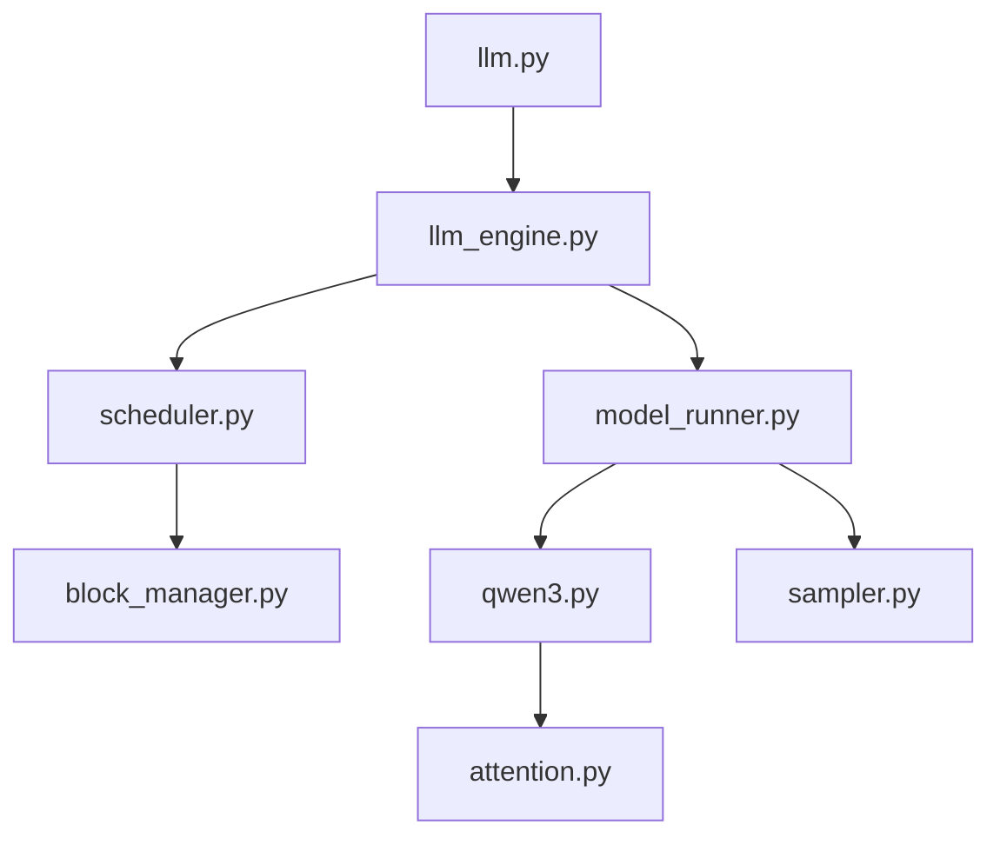

# GeeeekExplorer/nano-vllm

> A reimplementation of vLLM in about 1,200 lines of Python, readable and educational.

## The problem
vLLM's code is too big to understand how continuous batching, the KV cache or CUDA graphs work.

## What it actually does
It does offline inference with an API close to vLLM's (`LLM.generate`, `SamplingParams`).
It includes a continuous-batching scheduler, a KV block manager with prefix caching, tensor parallelism, `torch.compile` and CUDA graphs.
Only Qwen3 is supported (`qwen3.py`).
The benchmark on an RTX 4070 gives 1,434 tokens/s, against 1,362 for vLLM.

## How it is wired


## Trying it
```bash
pip install git+https://github.com/GeeeekExplorer/nano-vllm.git
huggingface-cli download --resume-download Qwen/Qwen3-0.6B --local-dir ~/huggingface/Qwen3-0.6B/ --local-dir-use-symlinks False
```

## Cost and gotchas
A CUDA GPU is required. There is no HTTP server and no streaming: offline inference only.

## What it is not
It is not a production substitute for vLLM: a single model, no OpenAI-compatible API. The benchmark covers a single configuration.

## Alternatives
- vLLM: the full production engine, which nano-vllm imitates.

## For you
Watch: an excellent resource for understanding the internals of LLM inference, but not a tool to deploy.
