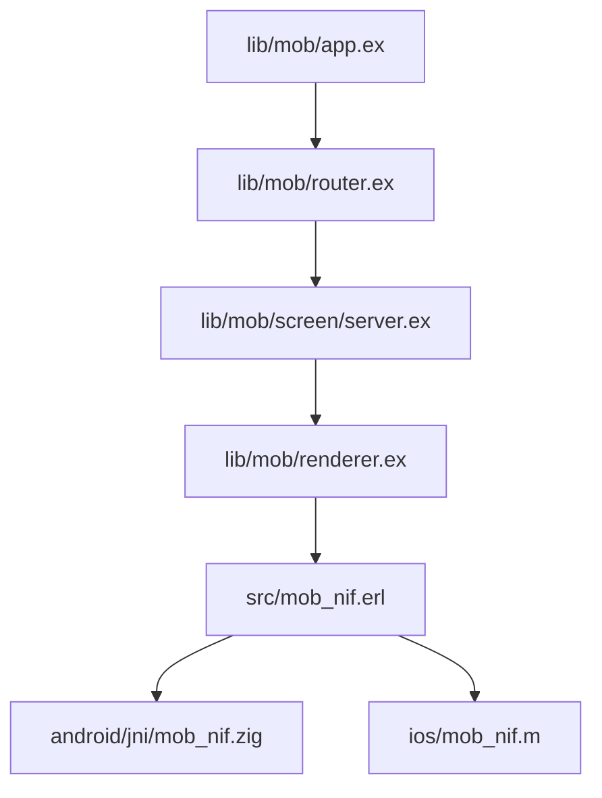

# GenericJam/mob

> Elixir framework that embeds the BEAM in iOS and Android apps, with no server.

## The problem
Writing a native mobile app in Elixir with no remote backend, using OTP supervision.

## What it actually does
Each screen is a GenServer (`Mob.Screen.Server`) whose component tree is converted to JSON by `Mob.Renderer`, then rendered by Compose (Android) or SwiftUI (iOS) through a NIF. Device APIs (haptics, camera, location) come as plugins, with a distributed connection to push hot bytecode.

## How it is wired


## Trying it
```bash
mix archive.install hex mob_new
mix mob.connect
mix setup
```

## Cost and gotchas
"Early development" status. The BEAM is suspended in the background on iOS: push notifications (APNs/FCM) are needed. Runtime of about 80 MB compressed.

## What it is not
Not React Native or Flutter: you have to write in Elixir and the rendering stays native.

## Alternatives
The README mentions LiveView Native, Elixir Desktop, React Native and Flutter.

## For you
Watch: interesting for embedded inference (Nx plugins, TFLite), but too young for MLOps use.
