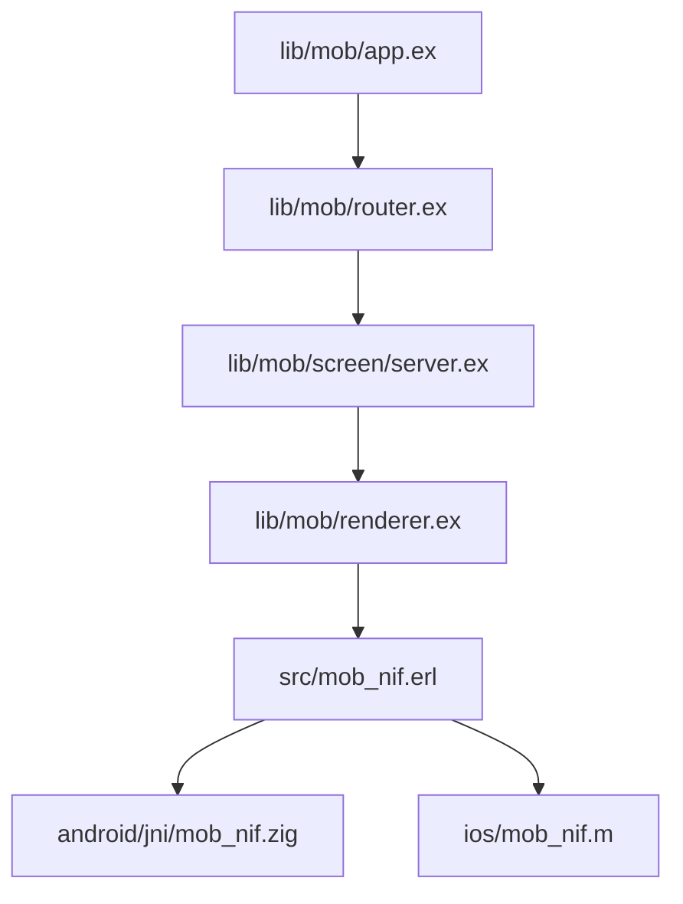

# GenericJam/mob

> Framework Elixir qui embarque la BEAM dans des apps iOS et Android, sans serveur.

## Le problème
Écrire une appli mobile native en Elixir sans backend distant, avec la supervision OTP.

## Ce que ça fait vraiment
Chaque écran est un GenServer (`Mob.Screen.Server`) dont l'arbre de composants est converti en JSON par `Mob.Renderer`, puis rendu par Compose (Android) ou SwiftUI (iOS) via un NIF. API d'appareil (haptique, caméra, localisation) en plugins, connexion distribuée pour pousser du bytecode à chaud.

## Comment c'est branché


## Essayer
```bash
mix archive.install hex mob_new
mix mob.connect
mix setup
```

## Coût et pièges
Statut « early development ». La BEAM est suspendue en arrière-plan sur iOS : il faut des notifications push (APNs/FCM). Runtime d'environ 80 Mo compressé.

## Ce que ce n'est pas
Pas React Native ni Flutter : il faut écrire en Elixir et le rendu reste natif.

## Alternatives
Le README cite LiveView Native, Elixir Desktop, React Native et Flutter.

## Pour toi
Surveiller : curieux pour de l'inférence embarquée (plugins Nx, TFLite), mais trop jeune pour un usage MLOps.

