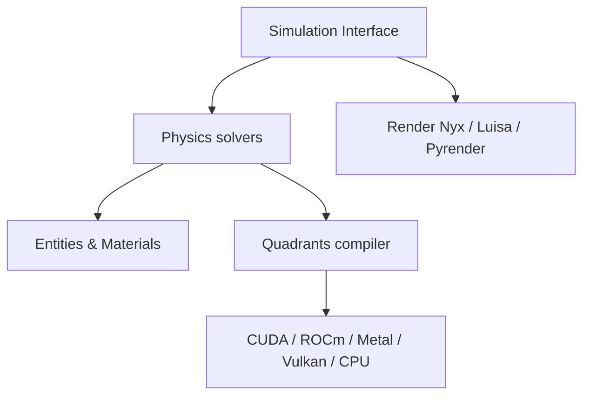

# Genesis-Embodied-AI/Genesis

> Physics simulation platform for robotics and embodied AI, driven from Python.

## The problem
Training and testing robots requires a simulator that unifies rigid bodies, fluids and deformables, and is fast on GPU.

## What it actually does
Python simulation interface (URDF, MJCF, USD formats…), multi-physics engine (rigid, FEM, MPM, SPH, PBD, coupling), three rendering engines (Nyx, Luisa, Pyrender) and a Quadrants compiler targeting CUDA, ROCm, Metal, Vulkan and CPU. Sensors (lidar, IMU, tactile), parallel environments, differentiable IK.

## How it is wired


## Trying it
```bash
pip install genesis-world
git clone https://github.com/Genesis-Embodied-AI/genesis-world.git
cd genesis-world
pip install -e ".[dev]"
uv run examples/rigid/single_franka.py
```

## Cost and gotchas
Install PyTorch first. The IPC solver requires pyuipc and an NVIDIA GPU on Linux/Windows x86. Python 3.10 to 3.13.

## What it is not
Not a reinforcement learning library: it is the simulator. The README renames the project Genesis World; the cataloged repo keeps the old name.

## Alternatives
- No alternative named in the README.

## For you
Worth watching: relevant if you do robotics or RL in simulation; otherwise out of scope.
