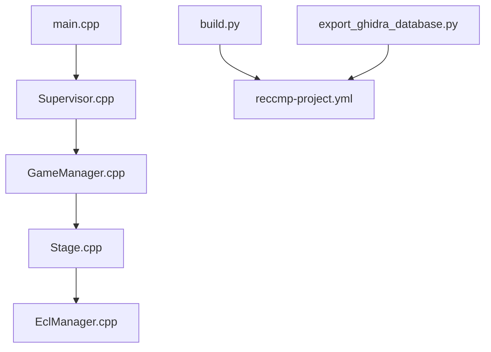

# GensokyoClub/th06

> Reconstruction of the source code of Touhou 6 version 1.02h through byte-exact decompilation.

## The problem
The game's code is not published; the goal is to rebuild it by recovering an identical binary.

## What it actually does
A decompilation project that recompiles C++ sources until the original executable is reproduced. It runs a downloaded Visual Studio 2002 and DirectX 8 toolchain, then compares the result with the original using reccmp. An export of the Ghidra database lives in another repository.

## How it is wired


## Trying it
```bash
python scripts/create_devenv.py scripts/dls scripts/prefix
python3 ./scripts/build.py --build-type=binary_matchbuild
reccmp-reccmp --target th06 --html report.html
```

## Cost and gotchas
Free, but you must own the original 1.02h executable (copied to `resources/th06.exe`). Python 3.4+; wine and msiextract on Linux or macOS.

## What it is not
Not a playable game: a functional port lives on another branch.

## Alternatives
The repository's portable branch, for playing on other platforms.

## For you
Ignore: game decompilation unrelated to data, AI or MLOps work.
