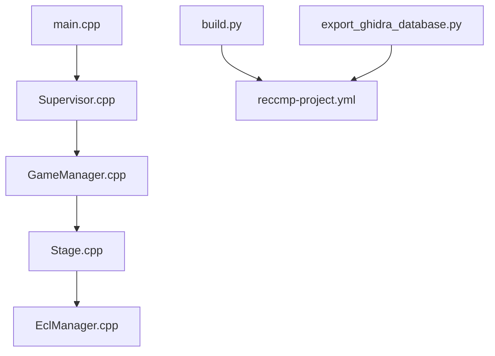

# GensokyoClub/th06

> Reconstruction du code source du jeu Touhou 6 version 1.02h par décompilation à l'octet près.

## Le problème
Le code du jeu n'est pas publié ; on veut le reconstruire en retrouvant un binaire identique.

## Ce que ça fait vraiment
Un projet de décompilation qui recompile des sources C++ jusqu'à retrouver l'exécutable d'origine. Il lance une chaîne Visual Studio 2002 et DirectX 8 téléchargée, puis compare le résultat à l'original avec reccmp. Un export de la base Ghidra vit dans un autre dépôt.

## Comment c'est branché


## Essayer
```bash
python scripts/create_devenv.py scripts/dls scripts/prefix
python3 ./scripts/build.py --build-type=binary_matchbuild
reccmp-reccmp --target th06 --html report.html
```

## Coût et pièges
Gratuit, mais il faut posséder l'exécutable d'origine 1.02h (copié dans `resources/th06.exe`). Python 3.4+ ; wine et msiextract sous Linux ou macOS.

## Ce que ce n'est pas
Pas un jeu jouable : un portage fonctionnel est sur une autre branche.

## Alternatives
La branche portable du dépôt, pour jouer sur d'autres plateformes.

## Pour toi
À ignorer : décompilation de jeu sans lien avec un travail data, IA ou MLOps.

