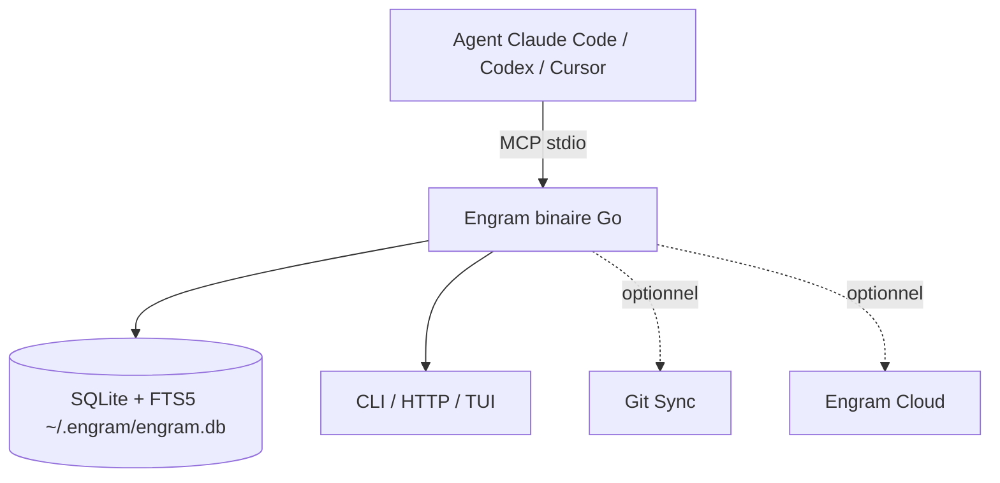

# Gentleman-Programming/engram

> Go binary giving coding agents persistent, searchable memory via MCP.

## The problem
A coding agent forgets everything at the end of a session; you re-explain the same decisions every morning. There is no mechanism to accumulate context over time.

## What it actually does
A single Go binary with SQLite + FTS5, exposed as CLI, HTTP API, MCP and TUI. Works with any MCP-compatible agent (Claude Code, OpenCode, Gemini CLI, Codex, Cursor…). No Node/Python/Docker. Usage contract for agents: get oriented (`mem_current_project`), search before repeating (`mem_search`), save deliberately (`mem_save`), stable subject keys (`topic_key`), end-of-session handoff. Local first; Git Sync and Engram Cloud are optional.

## How it is wired


## Trying it
```bash
brew install gentleman-programming/tap/engram
```
```bash
claude plugin marketplace add Gentleman-Programming/engram && claude plugin install engram
```

## Cost and gotchas
Free locally. Engram Cloud (replication) is optional. Homebrew stays on stable v1.20.0; release candidates = prerelease risk. Single maintainer.

## What it is not
Not a transcript sink: curated memory, not a dump of every conversation turn. Not cloud-dependent (local by default).

## Alternatives
- claude-mem: explicitly compared in the docs.

## For you
Directly useful if you want durable, searchable memory for Claude Code, with no heavy dependency. Keep an eye on it (single maintainer).
