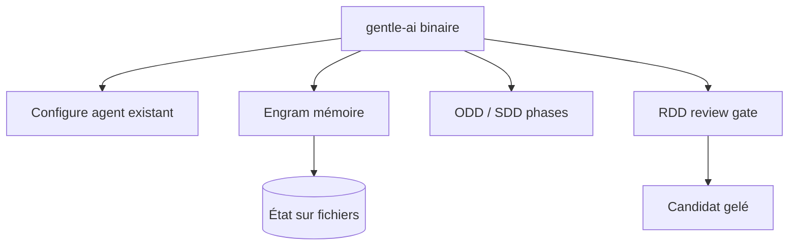

# Gentleman-Programming/gentle-ai

> Go binary that gives memory, workflow and proof to an existing coding agent.

## The problem
A coding agent forgets everything at the end of a session, has no opinion about the project, and cannot prove what it did without you reviewing every line.

## What it actually does
Configures 16 agents (Pi, Claude Code, Codex, Cursor...) without installing them. Engram: persistent project memory. ODD (Organic Driven Development) for small lightweight work, SDD for formal phases, RDD (Receipt-Driven) which freezes a candidate before review. The `gentle-ai` binary keeps state in files, deterministic across machines. Skills, Context7 MCP, CodeGraph, security deny-list, doctor.

## How it is wired


## Trying it
```bash
brew install gentleman-programming/tap/gentle-ai
```
```bash
gentle-ai
gentle-ai doctor
```

## Cost and gotchas
Free (MIT on the code). Telemetry (a dedicated page explains how to turn it off). Single maintainer (Alan Buscaglia); Gentle AI™/Engram™ are registered trademarks. Config snapshots before every write.

## What it is not
It never installs an AI agent for you: it configures the ones you already have. It is not an agent itself.

## Alternatives
- Gentleman-Programming/engram: the memory brick alone (same author).

## For you
Interesting if you run several coding agents and want shared memory/workflow; keep watching given the single maintainer.
