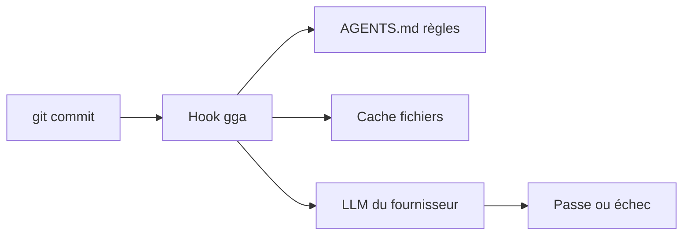

# Gentleman-Programming/gentleman-guardian-angel

> Bash pre-commit hook that has any LLM review the staged files.

## The problem
Your coding rules exist, your team ignores them, and the review comes too late.

## What it actually does
`gga` installs as a git hook. On every commit, it sends the staged files to an LLM of your choice along with the rules from your `AGENTS.md`, then gives a detailed pass or fail. It keeps a cache of unchanged files and has a full PR review mode. Listed providers: Claude, Gemini, Codex, OpenCode, Cursor Agent, Kilo, Kiro, Ollama, LM Studio, GitHub Models, MiniMax.

## How it is wired
Simplified diagram based on the sheet, no diagram provided.


## Trying it
```bash
brew install gentleman-programming/tap/gga
cd ~/your-project
gga init
gga install
```

## Cost and gotchas
The cost depends on the chosen provider (CLI or API key); Ollama or LM Studio locally avoid the bill. Under Oh My Zsh, the `gga` alias conflicts with the git plugin.

## What it is not
It is not a deterministic linter: the verdict comes from an LLM, so it may vary. Nor is it a human review.

## Alternatives
No alternative named in the README.

## For you
Worth watching: lightweight (Bash) and provider-neutral, useful for enforcing rules in an ML repository, to be tried on a small repo.
