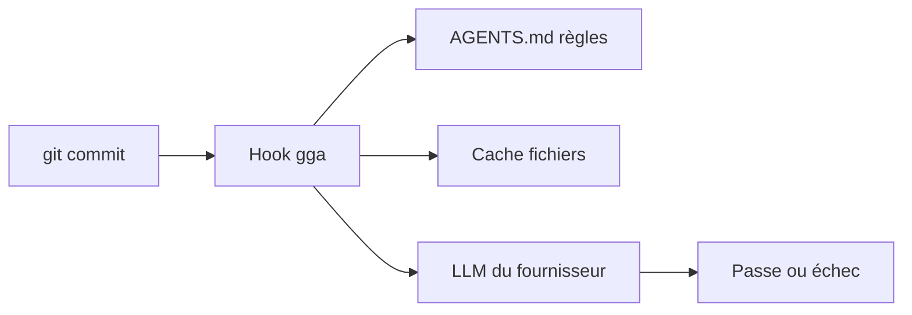

# Gentleman-Programming/gentleman-guardian-angel

> Hook de pré-commit en Bash qui fait relire les fichiers indexés par n'importe quel LLM.

## Le problème
Tes règles de code existent, ton équipe les ignore, et la revue arrive trop tard.

## Ce que ça fait vraiment
`gga` s'installe comme hook git. À chaque commit, il envoie les fichiers indexés à un LLM de ton choix avec les règles de ton `AGENTS.md`, puis donne un passe ou échec détaillé. Il gère un cache des fichiers inchangés et un mode de revue de PR complète. Fournisseurs listés : Claude, Gemini, Codex, OpenCode, Cursor Agent, Kilo, Kiro, Ollama, LM Studio, GitHub Models, MiniMax.

## Comment c'est branché
Schéma simplifié d'après la fiche, sans diagramme fourni.


## Essayer
```bash
brew install gentleman-programming/tap/gga
cd ~/your-project
gga init
gga install
```

## Coût et pièges
Le coût dépend du fournisseur choisi (CLI ou clé d'API) ; Ollama ou LM Studio en local évitent la facture. Sous Oh My Zsh, l'alias `gga` entre en conflit avec le plugin git.

## Ce que ce n'est pas
Ce n'est pas un linter déterministe : le verdict vient d'un LLM, donc il peut varier. Ce n'est pas non plus une revue humaine.

## Alternatives
Aucune alternative nommée dans le README.

## Pour toi
À surveiller : léger (Bash) et neutre vis-à-vis du fournisseur, utile pour faire respecter des règles dans un dépôt ML, à tester sur un petit repo.

