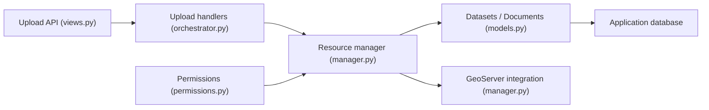

# GeoNode/geonode

> Django platform for managing and publishing geospatial data, to share maps and datasets.

## The problem
Sharing layers, metadata and interactive maps with non-specialist users requires linking several GIS components.

## What it actually does
Receives geospatial files through an upload API, processes them with format handlers, records them via a resource manager and synchronizes them with GeoServer. Metadata, permissions (public or restricted), groups, comments, ratings, catalog, harvesting, interactive maps, faceted search.

## How it is wired


## Trying it
```bash
python create-envfile.py
docker compose build
docker compose up -d
```

## Cost and gotchas
Heavy stack (GeoServer, PostgreSQL); in `prod`, a real email and an SMTP config are required for Let's Encrypt. Do not modify the core: use the GeoNode Project Template.

## What it is not
Not an ML tool. The README mentions GPL v3 (copyleft, OSGeo rights) while GitHub does not identify the license: check before reuse.

## Alternatives
- GeoNode Project (geonode-project): template to customize an instance.

## For you
Worth watching: relevant if your projects handle geospatial data to publish; off-topic for general ML.
