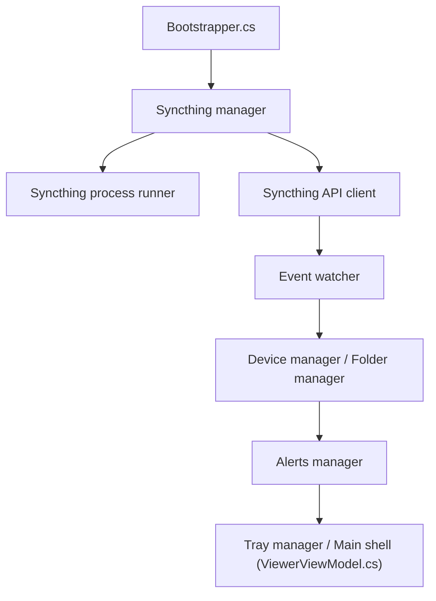

# GermanCoding/SyncTrayzor

> Windows taskbar utility that hosts Syncthing and makes it feel close to a native application.

## The problem
Syncthing is driven through a web interface and the command line, which is impractical on Windows: no start at login and no native notifications.

## What it actually does
It launches Syncthing, displays it in an embedded browser and adds a notification-area icon. It alerts on file conflicts, out-of-sync folders and device connections, and pauses devices on metered networks. It also provides a conflict resolution tool.

## How it is wired


## Trying it
```bash
winget install GermanCoding.SyncTrayzor
choco install synctrayzor
scoop install extras/synctrayzor
```

## Cost and gotchas
Free, Windows 10 or newer. The application overwrites Syncthing's interface listen address and API key. The auto-update contacts a server run by the author and reveals your version and IP address; it can be disabled in the settings.

## What it is not
It is not a synchronization engine: it is a Syncthing wrapper, and synchronization problems are Syncthing's. It only works on Windows. It is v2, a continuation of canton7's abandoned original.

## Alternatives
No alternative named in the README.

## For you
Ignore for your work: it is a Windows convenience for Syncthing, unrelated to data, AI or MLOps.
