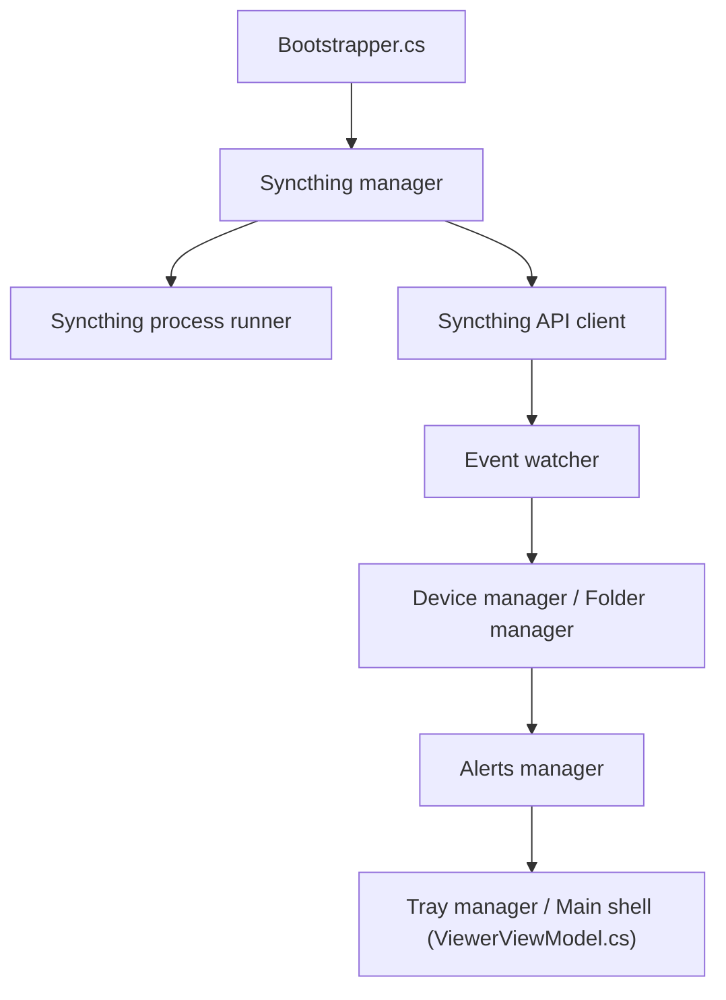

# GermanCoding/SyncTrayzor

> Utilitaire de barre des tâches Windows qui héberge Syncthing et le rend proche d'une application native.

## Le problème
Syncthing se pilote par une interface web et en ligne de commande, peu pratique sur Windows : pas de démarrage à l'ouverture de session ni de notifications natives.

## Ce que ça fait vraiment
Il lance Syncthing, l'affiche dans un navigateur intégré et ajoute une icône de zone de notification. Il alerte sur les conflits de fichiers, les dossiers désynchronisés et les connexions d'appareils, et met en pause les appareils sur réseau limité. Il fournit aussi un outil de résolution de conflits.

## Comment c'est branché


## Essayer
```bash
winget install GermanCoding.SyncTrayzor
choco install synctrayzor
scoop install extras/synctrayzor
```

## Coût et pièges
Gratuit, Windows 10 ou plus récent. L'application écrase l'adresse d'écoute de l'interface et la clé d'API de Syncthing. L'auto-update contacte un serveur de l'auteur et révèle ta version et ton adresse IP ; il se désactive dans les réglages.

## Ce que ce n'est pas
Ce n'est pas un moteur de synchronisation : c'est un wrapper de Syncthing, dont les problèmes de synchronisation relèvent de Syncthing. Il ne fonctionne que sous Windows. C'est la v2, continuation de l'original abandonné de canton7.

## Alternatives
Aucune alternative nommée dans le README.

## Pour toi
À ignorer pour ton métier : c'est un confort Windows pour Syncthing, sans lien avec data, IA ou MLOps.

