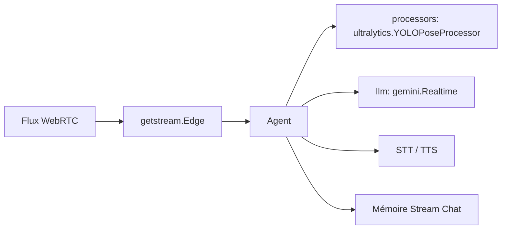

# GetStream/Vision-Agents

> Python building blocks for real-time agents that watch video, listen and answer live.

## The problem
Plugging a vision model into a WebRTC stream means stitching together the video edge, turn detection, STT, TTS and the LLM call yourself, with tolerable latency.

## What it actually does
Assembles an agent from an edge (Stream by default), an LLM or a real-time model, and a list of video *processors* that run before or after the model call — YOLO, Roboflow, custom ONNX. Adds VAD and diarization, tool calling and MCP, Twilio/Telnyx telephony, RAG (TurboPuffer, Qdrant, Gemini FileSearch), session memory via Stream Chat, an HTTP server and Prometheus metrics.

## How it is wired


## Trying it
```bash
uv add vision-agents
uv add "vision-agents[getstream, openai, elevenlabs, deepgram]"
```

## Cost and gotchas
A Stream key must be created: 333,000 participant-minutes free per month, paid beyond that. Each LLM/STT/TTS provider adds its own bill. The example's YOLO processor requires `device="cuda"`, hence a GPU.

## What it is not
The README lists its own limits: video handles small text poorly and models hallucinate scores and signs; context degrades beyond ~30 s of continuous video; video alone does not trigger a response, audio or text is needed.

## Alternatives
No alternative named in the README — only integrated providers.

## For you
Worth a look if you are prototyping a real-time video agent; otherwise it is a lot of third-party dependencies.
